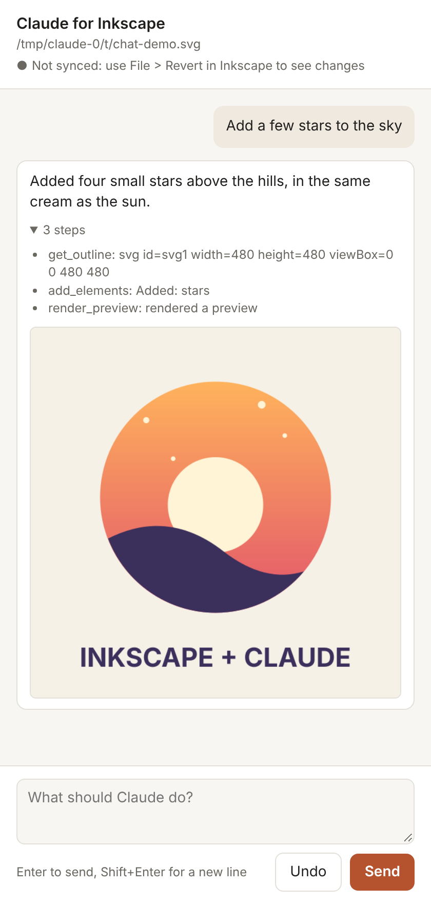

# Inkscape + Claude (prototype)

Three ways for Claude to work with Inkscape 1.x:

1. **`inkscape-mcp`**: an MCP server. Claude (in Claude Desktop, Claude Code, or any MCP client) can
   create and edit SVG documents, look at a rendered preview, and run Inkscape for booleans, alignment,
   any other Inkscape action, and export to PNG/PDF/EPS.
2. **Ask Claude…**: an Inkscape extension (`Extensions > Claude > Ask Claude…`). Type a prompt, and
   Claude edits the open drawing, only the selected objects, or adds new artwork. Ctrl+Z undoes it.
3. **Chat panel**: a chat page next to Inkscape for a longer conversation about one drawing; on Linux the
   Inkscape window updates after every answer.


The badge above was drawn through the MCP server by `examples/demo_drawing.py`, using the same tool calls
Claude makes: create a page, add shapes, a path intersection, page alignment, then export.

## 1. MCP server

### Install

```bash
cd mcp_server
pip install .            # needs Python 3.10+; installs `mcp` (2.x), `lxml`, `anthropic` and both commands
```

Inkscape 1.x must be installed for previews, exports and actions. The server finds it on `PATH`,
in the usual macOS/Windows install folders, or at `INKSCAPE_BIN`. Plain SVG editing works without it.

### Connect it to Claude

**Claude Code**

```bash
claude mcp add inkscape -- inkscape-mcp
```

**Claude Desktop**: add to `claude_desktop_config.json`:

```json
{
  "mcpServers": {
    "inkscape": {
      "command": "inkscape-mcp",
      "env": { "INKSCAPE_MCP_WORKSPACE": "/Users/you/Drawings" }
    }
  }
}
```

Then ask something like *"Draw a 600×400 poster for a jazz night in poster.svg, check the preview,
and export a PDF."*

### Tools

| Tool | What it does |
| --- | --- |
| `create_document` | New blank document (with a layer and any number of pages) or from full SVG source |
| `read_document` | Compact outline of pages and elements (ids, labels, fills, text, optional bounding boxes and the page each element is on) or full source |
| `write_document` | Replace the whole document |
| `add_elements` / `update_element` / `replace_element` / `delete_elements` / `get_element` | Element-level edits; new elements get unique ids |
| `render_preview` | Renders every page, one page or one object to PNG and returns the image so Claude can check its work |
| `export_document` | PNG, PDF, EPS, PS, EMF, WMF or plain SVG; one page, all pages, the drawing or one object; DPI/size |
| `boolean_operation` | Union, difference, intersection, exclusion, division, cut, combine |
| `align_objects` | Inkscape's Align tool (relative to page, drawing, selection, first, last…); with several pages, "page" means the object's own page or the one you name |
| `run_actions` | Any Inkscape 1.x action list, e.g. `["select-by-id:a,b", "object-flip-horizontal"]` |
| `list_actions` | Searches the action names Inkscape knows |
| `get_bounding_boxes` | Inkscape-measured geometry (handles text, transforms and strokes) |
| `undo_last_change` | Every edit snapshots the file first; this steps back one snapshot |
| `list_documents`, `inkscape_info`, `open_in_inkscape` | Housekeeping; the last opens the file in the Inkscape app |

### Pages (artboards)

Inkscape 1.2 and later can hold several pages on one canvas. Claude sees them in every outline and can work
with them directly:

| Tool | What it does |
| --- | --- |
| `list_pages` | Each page's number, id, label, position and size, and the objects on it (plus anything off every page) |
| `add_page` | Adds a page, by default the size of the last one and to its right |
| `update_page` | Renames, moves or resizes a page |
| `delete_page` | Removes a page; its objects stay on the canvas |
| `move_to_page` | Moves objects to another page, keeping their spot on the page |

Pages can be named by number (from 1), id or label, e.g. `page="Back"`. Positions and sizes are in the
document's user units, the same numbers as in the SVG, so in a millimetre document they are millimetres.
A document with no pages defined has one page: its viewBox.

### Live control (Linux)

On Linux, Inkscape publishes its actions on the session D-Bus, so Claude can work on the window you have
open and you see each change as it happens:

| Tool | What it does |
| --- | --- |
| `live_status` | Whether a running Inkscape can be reached, and its window/document numbers |
| `live_open` | Opens a workspace file in the running Inkscape (starts it if needed) |
| `live_run_actions` | Runs actions in the window, e.g. `["select-by-id:logo", "object-align:hcenter page"]`; Ctrl+Z undoes them |
| `live_snapshot` | A PNG of what is in the window now, unsaved changes included |
| `live_pull` | Copies the window's document, unsaved changes included, into a workspace file |
| `live_save` / `live_reload` | File > Save and File > Revert, so file edits made with the other tools show up in the window |

The usual loop for bigger edits is `live_save`, edit the file with the normal tools, then `live_reload`.
Live control needs the `gdbus` command (part of GLib, installed on most desktops). On macOS and Windows these
tools report that live control is unavailable; edit the file and use File > Revert instead.

### Settings (environment variables)

| Variable | Default | Meaning |
| --- | --- | --- |
| `INKSCAPE_MCP_WORKSPACE` | `~/InkscapeClaude` | Folder relative paths resolve in. Paths outside it are refused. |
| `INKSCAPE_MCP_ALLOW_ANY_PATH` | off | Set to `1` to allow any path on disk. |
| `INKSCAPE_BIN` | auto-detect | Path to the Inkscape executable. |
| `INKSCAPE_TIMEOUT` | `120` | Seconds before an Inkscape run is stopped. |

## 2. "Ask Claude…" extension

### Install

Build the package and unzip it into your Inkscape user extensions folder, then restart Inkscape:

```bash
python scripts/package_extension.py     # writes dist/ask-claude-extension.zip
```

The zip holds a `claude/` folder with both menu items (Ask Claude and Open Claude Chat) and the
`inkscape_mcp` code they share with the MCP server. Find the extensions folder in **Edit > Preferences > System > User extensions**. Typical locations:

- Linux: `~/.config/inkscape/extensions/`
- macOS: `~/Library/Application Support/org.inkscape.Inkscape/config/inkscape/extensions/`
- Windows: `%APPDATA%\inkscape\extensions\`

### API key

Get a key from the [Claude Console](https://platform.claude.com/), then do one of:

- paste it in the extension's **Settings** tab, or
- set `ANTHROPIC_API_KEY` in the environment Inkscape starts from, or
- create `~/.config/inkscape-claude/config.json` (Windows: `%APPDATA%\inkscape-claude\config.json`)
  containing `{"api_key": "sk-ant-..."}`.

### Use

**Extensions > Claude > Ask Claude…**, type what you want, and press Apply.

- **How**: *Step by step with Inkscape tools* (default) lets Claude look at the outline, make focused edits,
  run booleans and alignment in Inkscape, and check a rendered preview before it finishes, the same tools
  the MCP server offers. *Rewrite the SVG in one go* is faster and asks Claude for the finished SVG directly.
- **Apply to**: the selection if there is one, otherwise the whole drawing (default); or force whole
  drawing / selection only; or *Add new artwork* to the current layer without touching anything else.
- A picture of the canvas, covering every page, is sent along by default so Claude can see what it is editing.
  Claude is also told the position, size and label of each page, and which page the selection is on.
- Defaults: model `claude-opus-5-5`, adaptive thinking, effort `medium`. Change them in Settings.
- In rewrite mode, embedded raster images are swapped for short placeholders before sending and restored
  afterwards, so a photo in the document does not use up the request.
- Claude's SVG is cleaned before it goes in: scripts, event handlers, `foreignObject` and external links
  are removed. Ids that clash with existing ones are renamed.

If the `anthropic` Python package is installed in the Python that Inkscape uses, the extension uses it
(with streaming). Otherwise it falls back to a plain HTTPS request with the standard library, because
Inkscape's bundled Python on Windows and macOS usually does not have extra packages.

### Limits of this first version

- Inkscape freezes while Ask Claude waits for an answer (often 10–60 seconds), because extensions are
  one-shot. The chat panel avoids this: it runs outside Inkscape and keeps the conversation going.
- *Selection only* replaces the selected objects in place. If they sit in different groups or layers,
  the result goes where the first one was.
- Live control of an open window works on Linux only. On macOS and Windows the MCP server works on files;
  use `open_in_inkscape`, or File > Revert in Inkscape, to see changes made on disk.

## 3. Chat panel

A conversation with Claude that keeps going across many edits, in a browser page you keep next to
Inkscape. Claude edits the drawing step by step with the same tools as above (pages included), shows a preview of
every page after each answer, and remembers what you asked before ("now make those stars smaller").



Start it from Inkscape with **Extensions > Claude > Open Claude Chat…** (save the drawing first), or from a
terminal:

```bash
inkscape-claude-chat drawing.svg       # opens the file in Inkscape and the chat in your browser
```

- On Linux the chat keeps the Inkscape window in sync: before each message it saves the drawing, so Claude
  sees your latest changes, and afterwards it reloads the window to show Claude's edits. Elsewhere, use
  File > Revert in Inkscape after an answer.
- **Undo** reverts Claude's last edit, and Claude is told about it.
- The page only listens on 127.0.0.1 and needs a random token from the link it opens, so other websites
  cannot send it messages. Started from Inkscape, it stops after two hours without use.
- Options: `--model`, `--effort`, `--attach` (the file is already open in Inkscape), `--window N`,
  `--no-live`, `--no-browser`, `--port`, `--idle-minutes`.

## Tests

```bash
pip install pytest
python -m pytest tests            # the live test is skipped without a display; the extension runs against a fake Claude API, no key needed
python tests/smoke_mcp.py         # starts the MCP server and calls every tool once (needs Inkscape)
xvfb-run -a dbus-run-session -- python -m pytest tests/test_live.py   # live control against a real Inkscape window
python examples/demo_drawing.py   # draws the demo badge into the workspace
```

Tested with Inkscape 1.2.2, Python 3.13, `mcp` 2.3, `inkex` 1.4 and `anthropic` 2.6 on Linux.

## Ideas for next steps

- Run the chat panel inside Inkscape as a docked dialog once Inkscape's extension API allows it.
- Pick the right window automatically when several drawings are open (today live sync uses the newest
  window unless `--window` is given).
- Compact long chat conversations so they stay fast and cheap.
