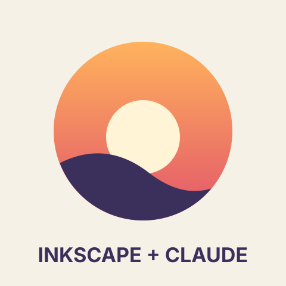
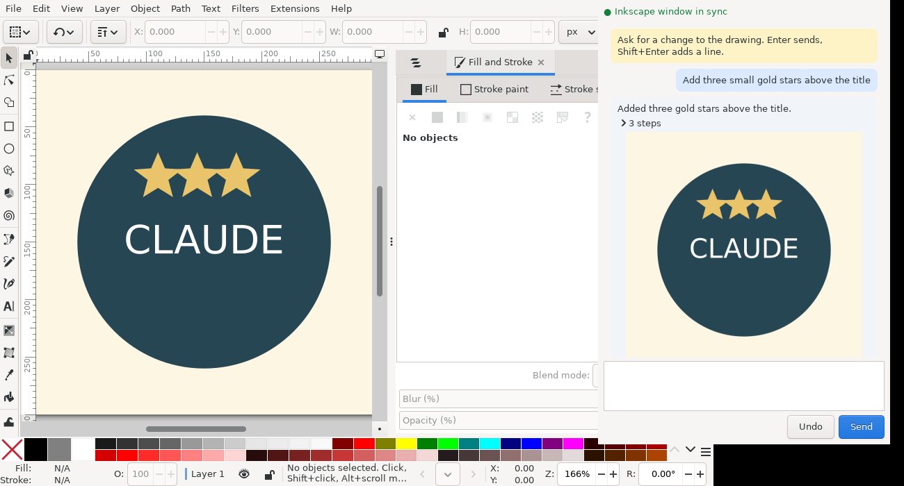

# Inkscape + Claude (prototype)

Three ways for Claude to work with Inkscape 1.x:

1. **`inkscape-mcp`**: an MCP server. Claude (in Claude Desktop, Claude Code, or any MCP client) can
   create and edit SVG documents, look at a rendered preview, and run Inkscape for booleans, alignment,
   any other Inkscape action, and export to PNG/PDF/EPS.
2. **Ask Claude…**: an Inkscape extension (`Extensions > Claude > Ask Claude…`). Type a prompt, and
   Claude edits the open drawing, only the selected objects, or adds new artwork. Ctrl+Z undoes it.
3. **Chat window**: a small window next to Inkscape for a longer conversation about one drawing; the Inkscape
   window updates after every answer. No browser needed.



The badge above was drawn through the MCP server by `examples/demo_drawing.py`, using the same tool calls
Claude makes: create a page, add shapes, a path intersection, page alignment, then export.

## Installers

Each [GitHub release](https://github.com/toneflix/inkscape-claude/releases) has an installer for Windows, macOS
and Linux. It puts the extension (Ask Claude and Open Claude Chat) in your Inkscape extensions folder and adds a
standalone `inkscape-mcp` command, so nothing needs pip or a separate Python. Restart Inkscape afterwards.

| System | File | Installs to |
| --- | --- | --- |
| Windows | `inkscape-claude-<version>-windows-x86_64.exe` | `%APPDATA%\inkscape\extensions\claude`, and `inkscape-mcp.exe` in `%LOCALAPPDATA%\Programs\Inkscape Claude` (added to your `PATH`). No administrator rights needed; remove it from Installed apps. |
| macOS | `inkscape-claude-<version>-macos-arm64.pkg` (Apple silicon) or `-x86_64.pkg` (Intel) | The signed-in user's Inkscape extensions folder, and `/usr/local/bin/inkscape-mcp`. Remove it with `sudo sh "/Library/Application Support/Inkscape Claude/uninstall.sh"`. |
| Linux | `inkscape-claude-<version>-linux-x86_64.run` | `~/.config/inkscape/extensions/claude` (plus the Flatpak and Snap Inkscape folders when they exist) and `~/.local/bin/inkscape-mcp`. Run it with `sh`; `--uninstall` removes it. |

The installers are not code-signed yet, so Windows SmartScreen asks you to confirm (**More info > Run anyway**)
and macOS blocks the first open (**System Settings > Privacy & Security > Open Anyway**).

Then connect the MCP server to Claude, for example `claude mcp add inkscape -- inkscape-mcp` (see below).

`.github/workflows/installers.yml` builds the installers and attaches them to a release when it is published
on GitHub (**Releases > Draft a new release**, pick or create a tag such as `v0.1.0`, **Publish**). Running the
workflow by hand from the Actions tab builds them as downloadable artifacts without a release. To build the
installer for your own system:

```bash
pip install pyinstaller ./mcp_server       # Windows also needs Inno Setup 6
python scripts/build_installer.py          # writes dist/inkscape-claude-<version>-<system>-<arch>.<exe|pkg|run>
```

## 1. MCP server

### Install

```bash
cd mcp_server
pip install .            # needs Python 3.10+; installs `mcp` (2.x), `lxml`, `anthropic` and both commands
```

Inkscape 1.x must be installed for previews, exports and actions. The server finds it on `PATH`,
in the usual macOS/Windows install folders, or at `INKSCAPE_BIN`. Plain SVG editing works without it.

### Connect it to Claude

**Claude Code**

```bash
claude mcp add inkscape -- inkscape-mcp
```

**Claude Desktop**: add to `claude_desktop_config.json`:

```json
{
  "mcpServers": {
    "inkscape": {
      "command": "inkscape-mcp",
      "env": { "INKSCAPE_MCP_WORKSPACE": "/Users/you/Drawings" }
    }
  }
}
```

Then ask something like *"Draw a 600×400 poster for a jazz night in poster.svg, check the preview,
and export a PDF."*

### Tools

| Tool | What it does |
| --- | --- |
| `create_document` | New blank document (with a layer and any number of pages) or from full SVG source |
| `read_document` | Compact outline of pages and elements (ids, labels, fills, text, optional bounding boxes and the page each element is on) or full source |
| `write_document` | Replace the whole document |
| `add_elements` / `update_element` / `replace_element` / `delete_elements` / `get_element` | Element-level edits; new elements get unique ids |
| `render_preview` | Renders every page, one page or one object to PNG and returns the image so Claude can check its work |
| `export_document` | PNG, PDF, EPS, PS, EMF, WMF or plain SVG; one page, all pages, the drawing or one object; DPI/size |
| `boolean_operation` | Union, difference, intersection, exclusion, division, cut, combine |
| `align_objects` | Inkscape's Align tool (relative to page, drawing, selection, first, last…); with several pages, "page" means the object's own page or the one you name |
| `run_actions` | Any Inkscape 1.x action list, e.g. `["select-by-id:a,b", "object-flip-horizontal"]` |
| `list_actions` | Searches the action names Inkscape knows |
| `get_bounding_boxes` | Inkscape-measured geometry (handles text, transforms and strokes) |
| `undo_last_change` | Every edit snapshots the file first; this steps back one snapshot |
| `list_documents`, `inkscape_info`, `open_in_inkscape` | Housekeeping; the last opens the file in the Inkscape app |

### Pages (artboards)

Inkscape 1.2 and later can hold several pages on one canvas. Claude sees them in every outline and can work
with them directly:

| Tool | What it does |
| --- | --- |
| `list_pages` | Each page's number, id, label, position and size, and the objects on it (plus anything off every page) |
| `add_page` | Adds a page, by default the size of the last one and to its right |
| `update_page` | Renames, moves or resizes a page |
| `delete_page` | Removes a page; its objects stay on the canvas |
| `move_to_page` | Moves objects to another page, keeping their spot on the page |

Pages can be named by number (from 1), id or label, e.g. `page="Back"`. Positions and sizes are in the
document's user units, the same numbers as in the SVG, so in a millimetre document they are millimetres.
A document with no pages defined has one page: its viewBox.

### Live control

Claude can work on an open Inkscape window, so you see each change as it happens:

| Tool | What it does |
| --- | --- |
| `live_status` | Whether a running Inkscape can be reached, and its window/document numbers |
| `live_open` | Opens a workspace file in the running Inkscape (starts it if needed) |
| `live_run_actions` | Runs actions in the window, e.g. `["select-by-id:logo", "object-align:hcenter page"]`; Ctrl+Z undoes them |
| `live_snapshot` | A PNG of what is in the window now, unsaved changes included |
| `live_pull` | Copies the window's document, unsaved changes included, into a workspace file |
| `live_save` / `live_reload` | File > Save and File > Revert, so file edits made with the other tools show up in the window |

The usual loop for bigger edits is `live_save`, edit the file with the normal tools, then `live_reload`.

How Claude reaches the window depends on the system:

- **D-Bus**: Inkscape publishes its actions on the session D-Bus wherever one is running, so Claude can follow
  any window, including one you opened yourself. Claude talks to it with the `gdbus` command.
  - Linux: works out of the box on most desktops (`gdbus` is part of GLib).
  - Windows: Inkscape starts a session bus itself and ships `gdbus.exe` next to `inkscape.exe`, so it should
    work with nothing to install.
  - macOS: install D-Bus and GLib with Homebrew, run the setup script once, then quit and reopen Inkscape:
    ```bash
    brew install dbus glib
    sh scripts/macos-dbus.sh          # starts a bus at login and tells apps opened from Finder where it is
    sh scripts/macos-dbus.sh status   # says whether Inkscape is on the bus
    ```
    `brew services start dbus` is not enough: GLib, which Inkscape uses, only finds a bus on macOS through
    `DBUS_SESSION_BUS_ADDRESS`, which the script sets for apps with `launchctl setenv`. Undo it with
    `sh scripts/macos-dbus.sh remove`.
- **Shell** (the fallback, or `INKSCAPE_MCP_LIVE=shell`): when no Inkscape answers on D-Bus, Claude opens the
  document itself with `live_open`. That starts Inkscape with its interactive shell attached, which Claude
  uses to run actions, save and reload. Work in that window. It is saved and closed when the MCP server
  stops. Reloading needs Inkscape 1.3 or later; on older versions use File > Revert.

D-Bus on macOS and Windows has been checked against Inkscape's source and tested on Linux with the same code
path, but not yet on a Mac or Windows machine.

### Settings (environment variables)

| Variable | Default | Meaning |
| --- | --- | --- |
| `INKSCAPE_MCP_WORKSPACE` | `~/InkscapeClaude` | Folder relative paths resolve in. Paths outside it are refused. |
| `INKSCAPE_MCP_ALLOW_ANY_PATH` | off | Set to `1` to allow any path on disk. |
| `INKSCAPE_BIN` | auto-detect | Path to the Inkscape executable. |
| `INKSCAPE_TIMEOUT` | `120` | Seconds before an Inkscape run is stopped. |
| `INKSCAPE_MCP_LIVE` | auto | `dbus` or `shell` to choose how live control reaches Inkscape (default: D-Bus when Inkscape answers on it, which is always tried on Linux; otherwise the shell). |

## 2. "Ask Claude…" extension

### Install

Build the package and unzip it into your Inkscape user extensions folder, then restart Inkscape:

```bash
python scripts/package_extension.py     # writes dist/ask-claude-extension.zip
```

The zip holds a `claude/` folder with both menu items (Ask Claude and Open Claude Chat) and the
`inkscape_mcp` code they share with the MCP server. Find the extensions folder in **Edit > Preferences > System > User extensions**. Typical locations:

- Linux: `~/.config/inkscape/extensions/`
- macOS: `~/Library/Application Support/org.inkscape.Inkscape/config/inkscape/extensions/`
- Windows: `%APPDATA%\inkscape\extensions\`

### API key

Get a key from the [Claude Console](https://platform.claude.com/), then do one of:

- paste it in the chat window's **Settings** (it asks on first start), or the Ask Claude extension's
  **Settings** tab, or
- set `ANTHROPIC_API_KEY` in the environment Inkscape starts from, or
- create `~/.config/inkscape-claude/config.json` (Windows: `%APPDATA%\inkscape-claude\config.json`)
  containing `{"api_key": "sk-ant-..."}`.

### Use

**Extensions > Claude > Ask Claude…**, type what you want, and press Apply.

- **How**: *Step by step with Inkscape tools* (default) lets Claude look at the outline, make focused edits,
  run booleans and alignment in Inkscape, and check a rendered preview before it finishes, the same tools
  the MCP server offers. *Rewrite the SVG in one go* is faster and asks Claude for the finished SVG directly.
- **Apply to**: the selection if there is one, otherwise the whole drawing (default); or force whole
  drawing / selection only; or *Add new artwork* to the current layer without touching anything else.
- A picture of the canvas, covering every page, is sent along by default so Claude can see what it is editing.
  Claude is also told the position, size and label of each page, and which page the selection is on.
- Defaults: model `claude-opus-5-5`, adaptive thinking, effort `medium`. Change them in Settings.
- In rewrite mode, embedded raster images are swapped for short placeholders before sending and restored
  afterwards, so a photo in the document does not use up the request.
- Claude's SVG is cleaned before it goes in: scripts, event handlers, `foreignObject` and external links
  are removed. Ids that clash with existing ones are renamed.

If the `anthropic` Python package is installed in the Python that Inkscape uses, the extension uses it
(with streaming). Otherwise it falls back to a plain HTTPS request with the standard library, because
Inkscape's bundled Python on Windows and macOS usually does not have extra packages.

### Limits of this first version

- Inkscape freezes while Ask Claude waits for an answer (often 10–60 seconds), because extensions are
  one-shot. The chat window avoids this: it runs outside Inkscape and keeps the conversation going.
- *Selection only* replaces the selected objects in place. If they sit in different groups or layers,
  the result goes where the first one was.
- Without D-Bus (see Live control), Claude can only follow an Inkscape window that it opened itself
  (`live_open`, or the chat window); a window you opened yourself needs File > Revert to show changes.

## 3. Chat window

A conversation with Claude that keeps going across many edits, in its own small window next to Inkscape.
Claude edits the drawing step by step with the same tools as above (pages included), shows a preview of every
page after each answer, and remembers what you asked before ("now make those stars smaller").



Start it from Inkscape with **Extensions > Claude > Open Claude Chat** (save the drawing first; there is no
dialog, the chat opens straight away), or from a terminal:

```bash
inkscape-claude-chat drawing.svg               # opens the file in Inkscape and the chat window
inkscape-claude-chat drawing.svg --ui browser  # the same chat as a page in your browser
```

- The chat keeps the Inkscape window in sync: before each message it saves the drawing, so Claude sees your
  latest changes, and afterwards it reloads the window to show Claude's edits.
- With D-Bus (see Live control) that is the window you already have open. Without it, the chat opens the
  drawing in its own Inkscape window and says so (started from Inkscape, close the original one so you don't
  edit two copies). The chat stops when you close that window, and saves and closes it when you stop the chat.
- **Settings** in the chat window holds how to reach Claude, the model, effort and API key. They are saved in
  the config file above, so Ask Claude uses the same key, and changes apply from the next message.
- Whatever you have selected in the Inkscape window goes with your message, so "make these blue" works. The
  chat shows which objects were sent. Pages can be named by number or label ("on page 2", "the Back page").
- **Undo** reverts Claude's last edit, and Claude is told about it. **Enter** sends, **Shift+Enter** adds a line.
- If the chat cannot start, Inkscape shows why. Its output goes to `chat.log` next to the config file
  (`~/.config/inkscape-claude/chat.log`, Windows: `%APPDATA%\inkscape-claude\chat.log`).
- The window uses GTK 3, which the Python bundled with Inkscape already has on Windows and macOS. Where GTK
  is missing, the chat opens in your browser instead.
- The browser page (`--ui browser`) only listens on 127.0.0.1 and needs a random token from the link it opens,
  so other websites cannot send it messages.
- Options: `--ui app|browser`, `--backend api|claude-code`, `--model`, `--effort`, `--attach` (the file is already open in Inkscape; needs
  D-Bus), `--window N`, `--no-live`, and for the browser page `--no-browser`, `--port`, `--idle-minutes`.

### Use your Claude subscription (Claude Code)

The chat can run through [Claude Code](https://claude.com/claude-code) instead of an API key, so it uses the
Pro or Max plan you signed in with:

1. Install Claude Code and run `claude` once to sign in.
2. In the chat's **Settings**, set **Connect with** to **Claude Code (your subscription)**. Without an API key
   the chat picks this by itself when it finds `claude`.

Each message runs `claude -p` with only the drawing tools above (no shell or file tools), served for this one
drawing by a small built-in MCP server that needs nothing beyond Inkscape's own Python. Claude Code keeps the
conversation between messages, and Undo works as before. `ANTHROPIC_API_KEY` is not passed on, so the
subscription is what gets used. If the chat cannot find `claude` (apps started from a menu often have a short
`PATH`), set `CLAUDE_CODE_BIN` or put `{"claude_path": "/path/to/claude"}` in the config file.

## Tests

```bash
pip install pytest
python -m pytest tests            # the live test is skipped without a display; the extension runs against a fake Claude API, no key needed
python tests/smoke_mcp.py         # starts the MCP server and calls every tool once (needs Inkscape)
xvfb-run -a dbus-run-session -- python -m pytest tests/test_live.py   # live control against a real Inkscape window
xvfb-run -a python -m pytest tests/test_shell.py                      # live control through the shell (macOS/Windows path)
xvfb-run -a python -m pytest tests/test_chat_window.py                # the chat window (needs GTK 3 bindings)
python examples/demo_drawing.py   # draws the demo badge into the workspace
```

Tested with Inkscape 1.2.2 and 1.4.2, Python 3.13, `mcp` 2.3, `inkex` 1.4 and `anthropic` 2.6 on Linux. The
shell path is the one macOS and Windows use, but it has only been run on Linux so far.

## Ideas for next steps

- Dock the chat inside Inkscape once Inkscape's extension API allows it.
- Pick the right window automatically when several drawings are open (today live sync uses the newest
  window unless `--window` is given).
- Compact long chat conversations so they stay fast and cheap.
